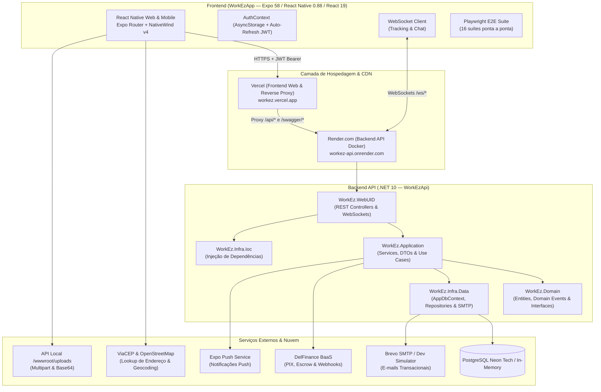

# 🚀 WorkEz — Plataforma Multifuncional de Serviços

<p align="center">
  
  
  
  
  
  
  
  
  
  
  
</p>

---

## 📖 Sumário

- [Visão Geral do Projeto](#-visão-geral-do-projeto)
- [Principais Funcionalidades](#-principais-funcionalidades)
- [Arquitetura do Sistema](#-arquitetura-do-sistema)
  - [Backend (.NET 10 — Clean Architecture + DDD)](#backend-net-10--clean-architecture--ddd)
  - [Frontend Mobile & Web (React Native + Expo)](#frontend-mobile--web-react-native--expo)
- [Ciclo de Vida do Chamado (State Machine)](#-ciclo-de-vida-do-chamado-state-machine)
- [Comunicação em Tempo Real (WebSockets)](#-comunicação-em-tempo-real-websockets)
- [Notificações Push e E-mails Transacionais](#-notificações-push-e-e-mails-transacionais)
- [Integração de Pagamentos, Custódia e Modelo de Taxa Justa](#-integração-de-pagamentos-custódia-e-modelo-de-taxa-justa)
- [Estrutura do Repositório](#-estrutura-do-repositório)
- [Catálogo de Endpoints (API REST)](#-catálogo-de-endpoints-api-rest)
- [Mapeamento de Rotas do App](#-mapeamento-de-rotas-do-app)
- [Pré-requisitos](#-pré-requisitos)
- [Como Rodar o Projeto](#-como-rodar-o-projeto)
  - [Opção 1: Scripts da Raiz (npm / Node)](#opção-1-scripts-da-raiz-npm--node)
  - [Opção 2: VS Code (F5 — Depuração Unificada)](#opção-2-vs-code-f5--depuração-unificada)
  - [Opção 3: Scripts Rápidos PowerShell](#opção-3-scripts-rápidos-powershell)
  - [Opção 4: Manualmente pelo Terminal](#opção-4-manualmente-pelo-terminal)
- [🧪 Testes Automatizados (Unitários e E2E)](#-testes-automatizados-unitários-e-e2e)
  - [Testes Unitários (.NET — 164 testes)](#1-testes-unitários-backend-net-10)
  - [Testes End-to-End (Playwright — 16 suítes)](#2-testes-end-to-end-playwright-workezapp)
- [Configuração de Variáveis de Ambiente](#-configuração-de-variáveis-de-ambiente)
- [Deploy e Infraestrutura](#-deploy-e-infraestrutura)
- [Integrantes e Autoria](#-integrantes-e-autoria)
- [Licença](#-licença)

---

## 🎯 Visão Geral do Projeto

O **WorkEz** é uma plataforma completa e moderna para intermediação e contratação de serviços residenciais e profissionais (encanadores, eletricistas, diaristas, técnicos, montadores, pintores, entre outros). A aplicação une **Clientes** que necessitam de auxílio prático a **Prestadores de Serviço** qualificados e avaliados, garantindo segurança, transparência e controle de ponta a ponta:

1. **Agilidade no Atendimento**: Mecanismo de abertura de chamado em poucos passos ("Chamar Agora"), com fotos locais ou na nuvem, múltiplos endereços e geolocalização.
2. **Leilão Transparente de Propostas**: O prestador discrimina custos entre **Mão de Obra** e **Materiais**, permitindo ao cliente comparar ofertas detalhadas e realizar contra-propostas.
3. **Rastreabilidade em Tempo Real**: WebSocket nativo para acompanhamento do deslocamento do prestador com atualização de coordenadas ao vivo no mapa.
4. **Chat Integrado**: Canal de comunicação bidirecional direto entre cliente e prestador por chamado ou proposta.
5. **Pagamento Seguro com PIX, Custódia (Escrow) e Taxa Justa**: Cobrança via gateway DelFinance BaaS com retenção de comissão de 15% **exclusivamente sobre o serviço/mão de obra** (materiais 100% repassados ao prestador).
6. **Notificações Multicanal**: Push notifications nativas (Expo Push Service) e e-mails transacionais (SMTP via Brevo ou simulador dev em log) a cada mudança de estado.
7. **Carteira Digital do Prestador (Wallet)**: Gestão de saldo disponível, saldo em custódia, extrato paginado e solicitação de saque instantâneo via chave PIX.
8. **Sistema Completo de Avaliações**: Notas (1 a 5 estrelas), tags de qualidade e comentários auditáveis após a conclusão do serviço.

---

## ✨ Principais Funcionalidades

### 👤 Para o Cliente (Customer)
- **Autenticação Segura**: Criação de conta, login unificado com JWT, persistência com auto-refresh token e recuperação de senha.
- **Catálogo de Categorias**: Busca de serviços por segmento profissional e listagem de prestadores recomendados.
- **Abertura de Chamados ("Chamar Agora")**: Descrição detalhada do problema, upload de múltiplas fotos (servidor local ou ImgBB) e busca de endereço por CEP (ViaCEP).
- **Gerenciamento de Endereços**: Cadastro de múltiplos endereços (casa, trabalho, outros) com geocodificação e seleção rápida.
- **Comparação e Aceite de Propostas**: Análise de propostas de múltiplos prestadores discriminando valores de serviço e peças, além da foto e avaliação de cada profissional.
- **Acompanhamento ao Vivo (Tracking)**: Notificação e mapa em tempo real via WebSocket (`Pendente` → `Aceito` → `A Caminho` → `Em Execução` → `Aguardando Pagamento` → `Concluído`).
- **Chat em Tempo Real**: Troca instantânea de mensagens com o profissional, com fechamento e bloqueio automático quando uma proposta é recusada.
- **Checkout com PIX**: Geração de QR Code e código Copia-e-Cola direto no app com reenvio opcional por e-mail, confirmação via webhook e polling.
- **Avaliações Reais e Flexíveis**: Envio de notas de 1 a 5 estrelas com comentários opcionais e tags de recomendação.

### 🛠️ Para o Prestador de Serviços (ServiceProvider)
- **Onboarding e Perfil Profissional**: Cadastro com foto de perfil, anos de experiência, biografia, especialidades, galeria de portfólio e envio de documentos.
- **Mural de Oportunidades com Filtro Geográfico**: Visualização inteligente de chamados abertos, ocultando automaticamente oportunidades fora do raio de atendimento do prestador.
- **Configuração de Raio de Atuação**: Definição do raio em km (5km a 100km) com preview interativo em mapa e geocodificação de endereço.
- **Galeria de Fotos do Chamado**: Visualização das imagens anexadas pelo cliente antes e depois do aceite.
- **Envio de Propostas e Leilão**: Formulação de propostas discriminando Mão de Obra e Materiais, com cálculo em tempo real do ganho líquido e da taxa da plataforma.
- **Controle Unificado de Atendimento**: Gestão direta do ciclo de atendimento (*Iniciar Deslocamento* ➔ *Iniciar Serviço* ➔ *Concluir Serviço*).
- **Carteira Digital Completa (Wallet)**: Consulta de saldo disponível, saldo retido em custódia (escrow), extrato detalhado e solicitação de transferência/saque PIX.
- **Gestão de Reputação**: Painel de avaliações recebidas com notas médias e depoimentos de clientes.

---

## 🏛️ Arquitetura do Sistema



### Backend (.NET 10 — Clean Architecture + DDD)

A API do backend foi estruturada seguindo rigorosamente os princípios de **Clean Architecture** e **Domain-Driven Design (DDD)**, dividida em projetos desacoplados dentro da solução [`WorkEz.slnx`](file:///d:/projetos/workEz/WorkEzApi/WorkEz.slnx):

- **[`WorkEz.Domain`](file:///d:/projetos/workEz/WorkEzApi/WorkEz.Domain)**: Núcleo do negócio. Entidades centrais (`User`, `Customer`, `ServiceProvider`, `Service`, `Proposal`, `Appointment`, `Review`, `ChatMessage`, `Category`, `Address`), Domain Events (`OrderStatusUpdated`, `ProviderAccepted`, `PaymentCompleted`), interfaces de repositórios e serviços de domínio (`EmailTemplateFactory`, `ProposalDomainService`).
- **[`WorkEz.Application`](file:///d:/projetos/workEz/WorkEzApi/WorkEz.Application)**: Camada de casos de uso e orquestração (`ServiceOpportunityApplicationService`, `ProposalApplicationService`, `ChatApplicationService`, `PortfolioApplicationService`, `WalletApplicationService`, `PushNotificationService`), cálculo da taxa justa da plataforma e DTOs tipados.
- **[`WorkEz.Infra.Data`](file:///d:/projetos/workEz/WorkEzApi/WorkEz.Infra.Data)**: `AppDbContext` em Entity Framework Core 10 com suporte a **PostgreSQL (Npgsql)** e fallback transparente para banco **In-Memory**, repositórios, mensageria interna (`BaseMessageBroker`) e serviço SMTP (`SmtpEmailService` com simulador em logs).
- **[`WorkEz.Infra.Ioc`](file:///d:/projetos/workEz/WorkEzApi/WorkEz.Infra.Ioc)**: Contêiner de Inversão de Controle (IoC), centralizando a injeção de dependências de todas as camadas.
- **[`WorkEz.WebUID`](file:///d:/projetos/workEz/WorkEzApi/WorkEz.WebUID)**: Ponto de entrada ASP.NET Core Web API, controllers REST, managers de WebSockets, autenticação JWT Bearer, tratamento de exceções, uploads locais e Swagger UI interativo.

### Frontend Mobile & Web (React Native + Expo)

O frontend foi desenvolvido em **React Native 0.88** com **Expo 58** e **React 19**, proporcionando experiência consistente tanto no navegador web quanto em dispositivos móveis:
- **Expo Router (File-based)**: Estrutura declarativa de rotas aninhadas com Route Guards por perfil (`/client` e `/provider`).
- **Estilização com NativeWind v4**: Classes utilitárias Tailwind CSS compiladas diretamente para componentes nativos e web.
- **Componentes Reutilizáveis**: [`ScreenHeader.tsx`](file:///d:/projetos/workEz/WorkEzApp/components/ScreenHeader.tsx) com safe-area automática, botões com feedback tátil, cartões de avaliação e preview de raio em mapa.
- **Context API & Hooks**: `AuthContext` com gerenciamento de sessão, token JWT, persistência segura com AsyncStorage e sincronização com o perfil remoto.
- **Qualidade & Confiabilidade**: Suíte automatizada com Playwright cobrindo 16 jornadas críticas ponta a ponta.

---

## 🔄 Ciclo de Vida do Chamado (State Machine)

O atendimento de um serviço transita por uma máquina de estados bem definida e auditável:

```
[ Cliente ] Cria Chamado
     │
     ▼
┌──────────────┐
│     Open     │ ──> Disponível no mural de oportunidades dos prestadores
└──────────────┘
     │
     │ [ Prestadores ] Enviam propostas discriminando Mão de Obra e Materiais
     │ [ Cliente ] Analisa e aceita a melhor proposta (ou faz contra-proposta)
     ▼
┌──────────────┐
│   Accepted   │ ──> Proposta e Agendamento (Appointment) confirmados
└──────────────┘
     │
     │ [ Prestador ] Inicia trajeto até o local
     ▼
┌──────────────┐
│   OnTheWay   │ ──> Rastreamento ao vivo ativado via WebSocket (/ws/tracking)
└──────────────┘
     │
     │ [ Prestador ] Chega ao endereço e inicia o trabalho
     ▼
┌──────────────┐
│  InProgress  │ ──> Execução da manutenção/serviço no local
└──────────────┘
     │
     │ [ Prestador ] Finaliza serviço e confirma valores acordados
     ▼
┌────────────────┐
│ WaitingPayment │ ──> Cobrança PIX gerada em custódia (Escrow) via DelFinance BaaS
└────────────────┘
     │
     │ [ Cliente ] Realiza pagamento PIX confirmado via Webhook ou Polling
     ▼
┌──────────────┐
│  Completed   │ ──> Concluído! Libera custódia para a carteira e abre avaliação
└──────────────┘
```

> **Cancelamento**: Qualquer chamado pode transitar para `Cancelled` antes da etapa de execução caso necessário, notificando ambas as partes.

---

## ⚡ Comunicação em Tempo Real (WebSockets)

O backend implementa dois canais nativos de WebSockets no ASP.NET Core:

### 1. Rastreamento de Deslocamento (`/ws/tracking`)
- **Endpoint**: `ws://localhost:5065/ws/tracking?serviceId={serviceId}`
- **Função**: Quando o prestador passa para o status `OnTheWay`, o aplicativo transmite atualizações periódicas de geolocalização. O cliente conectado na tela de rastreamento recebe essas coordenadas instantaneamente para atualizar a posição no mapa.

### 2. Chat em Tempo Real (`/ws/chat`)
- **Endpoint**: `ws://localhost:5065/ws/chat?proposalId={proposalId}` ou `?serviceId={serviceId}`
- **Função**: Troca instantânea de mensagens de texto entre o cliente e o prestador antes e durante o atendimento, sem dependência de polling HTTP.

---

## 🔔 Notificações Push e E-mails Transacionais

O ecossistema conta com comunicação ativa e multicanal:

1. **Push Notifications (Expo Push Service)**:
   - Registro automático do token do dispositivo (`POST /api/Notifications/register-device`).
   - Disparo de notificações quando uma proposta é recebida, aceita ou o status do serviço é alterado.
   - Remoção automática de token no logout (`POST /api/Notifications/remove-device`).

2. **E-mails Transacionais (SMTP com Templates Responsivos)**:
   - Padrão **Factory Pattern** (`EmailTemplateFactory`) com layout HTML responsivo e gradiente visual da marca WorkEz.
   - Disparo automático de e-mails em eventos do ciclo de vida:
     - Boas-vindas ao novo usuário cadastrado.
     - Notificação de nova proposta recebida e proposta aceita/recusada.
     - Atualização de status do serviço com badges informativos de transição.
     - Confirmação de pagamento e envio de fatura/PIX com QR Code.
   - **Dev Email Simulator**: Em ambiente de desenvolvimento ou caso as credenciais SMTP não estejam configuradas, os e-mails são logados de forma estruturada no console sem interrupção do fluxo.

---

## 💳 Integração de Pagamentos, Custódia e Modelo de Taxa Justa

A monetização e a cobrança ocorrem via **DelFinance BaaS** com proteção por custódia financeira (**Escrow**):

1. **Discriminação de Custos**:
   - **Mão de Obra (`LaborPrice`)**: Remuneração pelo serviço executado pelo profissional.
   - **Materiais (`MaterialsPrice`)**: Custos de peças e suprimentos comprovados.
2. **Modelo de Taxa Justa**: A comissão da plataforma (**15%**) incide **exclusivamente sobre o valor de mão de obra**. Os materiais são repassados integralmente (100%) ao prestador.
   $$\text{Taxa da Plataforma} = \text{Mão de Obra} \times 0.15$$
   $$\text{Ganho Líquido do Prestador} = (\text{Mão de Obra} \times 0.85) + \text{Materiais}$$
3. **Custódia (Escrow)**: Ao gerar o PIX (`POST /api/Wallet/checkout-pix/{serviceId}`), o montante é mantido seguro em custódia até a conclusão bem-sucedida do chamado.
4. **Confirmação Automatizada**: Processada por **Webhook** (`POST /api/Wallet/webhook/delfinance`) e verificação sob demanda (*polling*).
5. **Carteira Digital e Saques**:
   - O prestador acompanha o saldo disponível e valores em custódia (`GET /api/Wallet/summary/{providerId}`).
   - Extrato detalhado com filtros por período e tipo (`GET /api/Wallet/statement/{providerId}`).
   - Saque instantâneo via chave PIX para a conta bancária do profissional (`POST /api/Wallet/withdraw`).

---

## 📂 Estrutura do Repositório

```text
WorkEz/
├── .vscode/                               # Configurações de execução e depuração no VS Code
│   └── launch.json                        # Perfis de execução unificados (API + App + Web)
│
├── docs/                                  # Documentações arquiteturais e guias
│   ├── ARCHITECTURE.md                    # Detalhamento de DDD, Factory de e-mails e Domain Events
│   ├── VERCEL_HOSTING_GUIDE.md            # Guia mestre de hospedagem frontend e reverse proxy
│   └── adr/                               # Architecture Decision Records
│
├── vercel.json                            # Configuração de deploy da versão Web na Vercel com proxy reverso
├── render.yaml                            # Especificação IaC de deploy do backend Docker no Render
├── package.json                           # Scripts raiz unificados (npm run web, test:e2e, app...)
├── scripts/                               # Scripts utilitários de suporte
│   └── run-api.js                         # Runner multiplataforma Node para a API .NET
│
├── WorkEzApi/                             # Backend ASP.NET Core 10 (Clean Architecture + DDD)
│   ├── WorkEz.slnx                        # Solução XML do .NET
│   ├── Dockerfile                         # Contêiner Docker multi-stage para produção
│   ├── scripts/                           # Scripts SQL de migrations e sementes
│   │   ├── 003_add_proposal_labor_and_materials.sql # Migração de custos separados
│   │   └── 004_create_reviews_table.sql             # Migração da tabela de avaliações
│   ├── WorkEz.Domain/                     # Entidades, Enums, Interfaces, Domain Events e Email Factory
│   ├── WorkEz.Application/                # Casos de uso, DTOs, Wallet e Push Notifications
│   ├── WorkEz.Infra.Data/                 # AppDbContext, Repositories, EF Core e SmtpEmailService
│   ├── WorkEz.Infra.Ioc/                  # Registro de Injeção de Dependências
│   └── WorkEz.WebUID/                     # Controllers REST, WebSockets e Startup
│       ├── Controllers/                   # 16 Controllers REST (Auth, Services, Wallet, Addresses...)
│       ├── WebSockets/                    # Managers de WebSocket (Tracking e Chat)
│       └── Tests/                         # 17 suítes com 164 testes unitários automatizados xUnit
│
├── WorkEzApp/                             # Frontend React Native (Expo 58 Mobile & Web)
│   ├── app/                               # Rotas e páginas (Expo Router - File-based)
│   │   ├── client/                        # Fluxo do Cliente (detalhes, tracking, chat, endereços, avaliação)
│   │   └── provider/                      # Fluxo do Prestador (oportunidades, propostas, wallet, raio de atuação)
│   ├── components/                        # Componentes UI (ScreenHeader, Button, RatingCard, RadiusMapPreview)
│   ├── contexts/                          # AuthContext (sessão, tokens e sincronização com backend)
│   ├── services/                          # Clientes de API (api.ts com auto-resolução de host, imageService)
│   ├── playwright.config.ts               # Configuração do Playwright para testes E2E
│   └── e2e/                               # 16 suítes de testes automatizados ponta a ponta (Playwright)
│
├── run-all.ps1                            # Script PowerShell: sobe API e App simultaneamente
├── run-api.ps1                            # Script PowerShell: sobe apenas a API .NET
├── run-app.ps1                            # Script PowerShell: sobe apenas o Expo Mobile
└── README.md                              # Guia mestre do repositório
```

---

## 📡 Catálogo de Endpoints (API REST)

A API disponibiliza documentação interativa Swagger em `http://localhost:5065/swagger` (ou `/swagger` na nuvem). Abaixo estão os principais endpoints organizados por domínio:

| Módulo | Método | Rota | Descrição |
|:---|:---:|:---|:---|
| **Health** | `GET` | `/health` | Verificação de disponibilidade da API |
| **Auth** | `POST` | `/api/Auth/register/customer` | Registro de novo cliente |
| **Auth** | `POST` | `/api/Auth/register/provider` | Registro de novo prestador de serviços |
| **Auth** | `POST` | `/api/Auth/login` | Login unificado (retorna JWT e Refresh Token) |
| **Auth** | `POST` | `/api/Auth/refresh-token` | Renovação silenciosa de token de acesso |
| **Auth** | `POST` | `/api/Auth/revoke-token` | Logout seguro com invalidação do refresh token |
| **Users** | `GET` | `/api/Users/profile` ou `/me` | Consulta os dados do perfil do usuário autenticado |
| **Users** | `PUT` | `/api/Users/profile` | Atualiza nome, e-mail, telefone e foto de perfil |
| **Users** | `GET` | `/api/Users/{id}` | Consulta os dados públicos de um usuário pelo ID |
| **Addresses** | `GET` | `/api/Addresses/my-addresses` | Lista todos os endereços salvos do usuário autenticado |
| **Addresses** | `POST` | `/api/Addresses` | Cadastra novo endereço com coordenadas e geolocalização |
| **Addresses** | `PUT` | `/api/Addresses/{id}` | Atualiza dados de um endereço existente |
| **Addresses** | `DELETE` | `/api/Addresses/{id}` | Remove um endereço salvo |
| **Addresses** | `GET` | `/api/Addresses/lookup/{zipCode}` | Consulta dados de logradouro via CEP (ViaCEP) |
| **Services** | `POST` | `/api/Services/by-customer/{customerId}` | Criação de novo chamado ("Chamar Agora") |
| **Services** | `GET` | `/api/Services/{id}` | Detalhes completos do chamado |
| **Services** | `GET` | `/api/Services/by-customer/{customerId}` | Histórico de chamados do cliente |
| **Services** | `GET` | `/api/Services/opportunities-by-user/{userId}` | Mural de chamados abertos no raio do prestador |
| **Services** | `GET` | `/api/Services/by-provider-user/{userId}` | Chamados aceitos e em andamento do prestador |
| **Services** | `POST` | `/api/Services/{id}/accept` | Aceite direto da oportunidade pelo prestador |
| **Services** | `PATCH` | `/api/Services/{id}/start-displacement` | Atualiza status para `OnTheWay` |
| **Services** | `PATCH` | `/api/Services/{id}/start` | Atualiza status para `InProgress` |
| **Services** | `PATCH` | `/api/Services/{id}/complete?price={val}` | Conclui serviço e avança para `WaitingPayment` |
| **Services** | `PATCH` | `/api/Services/{id}/cancel` | Cancela o chamado e notifica as partes |
| **Proposals** | `POST` | `/api/Proposals` | Cria proposta discriminando `LaborPrice` e `MaterialsPrice` |
| **Proposals** | `POST` | `/api/Proposals/{id}/counter` | Cliente realiza contra-proposta de valor |
| **Proposals** | `POST` | `/api/Proposals/{id}/accept` | Aceita a proposta selecionada e gera agendamento |
| **Wallet** | `GET` | `/api/Wallet/summary/{providerId}` | Resumo financeiro (saldo disponível, em custódia e total) |
| **Wallet** | `GET` | `/api/Wallet/statement/{providerId}` | Extrato detalhado com paginação e filtros |
| **Wallet** | `POST` | `/api/Wallet/withdraw` | Solicitação de saque/transferência via chave PIX |
| **Wallet** | `POST` | `/api/Wallet/checkout-pix/{serviceId}` | Gera cobrança PIX com QR Code e código Copia-e-Cola (Escrow) |
| **Wallet** | `POST` | `/api/Wallet/resend-pix-email/{serviceId}` | Reenvia dados do PIX e QR Code para o e-mail do cliente |
| **Wallet** | `POST` | `/api/Wallet/webhook/delfinance` | Webhook de liquidação DelFinance para liberação de custódia |
| **Reviews** | `POST` | `/api/Reviews` | Cria ou atualiza avaliação (nota 1 a 5, comentário e tags) |
| **Reviews** | `GET` | `/api/Reviews/by-user/{userId}` | Lista avaliações recebidas pelo prestador |
| **Reviews** | `GET` | `/api/Reviews/by-service/{serviceId}` | Obtém a avaliação associada a um chamado |
| **Notifications** | `POST` | `/api/Notifications/register-device` | Registra/atualiza Expo Push Token do dispositivo |
| **Notifications** | `POST` | `/api/Notifications/remove-device` | Remove Expo Push Token do dispositivo no logout |
| **Emails** | `POST` | `/api/Emails/test-send` | Endpoint de diagnóstico e envio manual de e-mail de teste |
| **Uploads** | `POST` | `/api/Uploads` | Upload multipart de imagem (persistência em `/wwwroot/uploads/`) |
| **Uploads** | `POST` | `/api/Uploads/base64` | Upload de imagem codificada em Base64 |
| **Categories** | `GET` | `/api/Categories` | Lista todas as categorias de serviços cadastradas |
| **Providers** | `GET` | `/api/ServiceProviders/by-user/{userId}` | Obtém perfil do prestador pelo ID de usuário |
| **Providers** | `GET` | `/api/ServiceProviders/{id}/portfolio` | Lista fotos e trabalhos do portfólio |
| **Providers** | `POST` | `/api/ServiceProviders/{id}/portfolio` | Adiciona fotos ao portfólio profissional |
| **Chat** | `GET` | `/api/Chat/by-service/{serviceId}` | Histórico de mensagens do chamado |
| **Chat** | `POST` | `/api/Chat/send` | Envio de mensagem HTTP fallback |
| **WebSockets** | `GET` | `/ws/tracking?serviceId={id}` | Canal de transmissão de coordenadas GPS em tempo real |
| **WebSockets** | `GET` | `/ws/chat?serviceId={id}` | Canal bidirecional de mensagens instantâneas |

---

## 📱 Mapeamento de Rotas do App

O aplicativo possui navegação modular com proteção de rotas (Route Guards) organizadas em três seções:

### 1. Rotas Públicas e Comuns
- `/` ➔ Splash Screen de inicialização.
- `/onboarding` ➔ Apresentação das funcionalidades da plataforma.
- `/profile-choice` ➔ Seleção de modalidade de conta (Cliente ou Prestador).
- `/login` ➔ Formulário de login com atalhos de preenchimento rápido para testes.
- `/signup` ➔ Cadastro de cliente.
- `/forgot-password` ➔ Fluxo de recuperação de senha.
- `/help` ➔ Central de ajuda e perguntas frequentes (FAQ).
- `/colors` ➔ Vitrine de tokens do design system (`WorkEzTheme`).
- `/cancel/[id]` ➔ Fluxo de cancelamento de chamado com justificativa.
- `/activate-guarantee/[id]` ➔ Solicitação de garantia de serviço concluído.

### 2. Área do Cliente (`/client/*`)
- `/client` ➔ Home com catálogo de especialidades e botão principal "Chamar Agora".
- `/client/describe` ➔ Abertura de chamado com fotos, descrição e seleção de endereço.
- `/client/confirm` ➔ Revisão e confirmação das informações do chamado.
- `/client/searching` ➔ Mural de busca e aguardo de propostas de profissionais.
- `/client/found` ➔ Visualização da melhor proposta e perfil do prestador selecionado.
- `/client/tracking/[id]` ➔ Rastreamento do prestador ao vivo no mapa via WebSocket.
- `/client/chat/[id]` ➔ Chat em tempo real com o profissional.
- `/client/payment/[id]` ➔ Checkout PIX com QR Code dinâmico e código Copia-e-Cola.
- `/client/completed/[id]` ➔ Confirmação de conclusão e comprovante do serviço.
- `/client/rating/[id]` ➔ Avaliação pós-serviço (estrelas, comentários e tags de qualidade).
- `/client/professional/[id]` ➔ Perfil público do prestador com histórico de avaliações reais.
- `/client/addresses` ➔ Gerenciamento de múltiplos endereços cadastrados.
- `/client/favorites` ➔ Lista de prestadores favoritados pelo cliente.
- `/client/payment-methods` ➔ Gerenciamento de preferências de pagamento.
- `/client/guarantee` ➔ Termos e coberturas da garantia WorkEz.
- `/client/profile` ➔ Painel do perfil do cliente.
- `/client/edit-profile` ➔ Edição de dados cadastrais, telefone e foto de perfil.
- `/client/services` ➔ Histórico completo de chamados solicitados.

### 3. Área do Prestador (`/provider/*`)
- `/provider` ➔ Painel de controle do prestador com métricas e chamados ativos.
- `/provider/calls` ➔ Mural de oportunidades abertas e histórico de atendimentos.
- `/provider/new-call/[id]` ➔ Detalhes do chamado aberto e envio de proposta detalhada.
- `/provider/accepted/[id]` ➔ Central de execução do serviço (*Deslocamento* ➔ *Execução* ➔ *Conclusão*).
- `/provider/chat/[id]` ➔ Chat direto com o cliente contratante.
- `/provider/inform-value/[id]` ➔ Ajuste de valores acordados de mão de obra e peças.
- `/provider/ratings` ➔ Painel de avaliações recebidas e feedback de clientes.
- `/provider/wallet` ➔ Carteira digital com extrato financeiro, saldo em custódia e solicitação de saque PIX.
- `/provider/work-area` ➔ Configuração do raio de atuação em km com preview no mapa interativo.
- `/provider/portfolio` ➔ Galeria de fotos de trabalhos anteriores.
- `/provider/documents` ➔ Envio e validação de documentos profissionais.
- `/provider/references` ➔ Cadastro de referências profissionais.
- `/provider/interview` ➔ Agendamento e status de entrevista técnica.
- `/provider/analysis` ➔ Status do processo de verificação cadastral.
- `/provider/profile` ➔ Perfil profissional visível para clientes.
- `/provider/edit-profile` ➔ Edição de biografia, foto, experiência e especialidades.
- `/provider/settings` ➔ Configurações gerais da conta e preferências.
- `/provider/signup` ➔ Formulário de cadastro de prestador de serviços.

---

## 💻 Pré-requisitos

Antes de iniciar, certifique-se de possuir instalado em seu ambiente:

1. **[.NET 10 SDK](https://dotnet.microsoft.com/download/dotnet/10.0)** (ou superior)
2. **[Node.js](https://nodejs.org/)** (v18.x ou v20.x LTS recomendado)
3. **npm** (incluso com o Node.js)
4. **Git**
5. *(Opcional)* Aplicativo **Expo Go** no celular físico ([Android](https://play.google.com/store/apps/details?id=host.exp.exponent) / [iOS](https://apps.apple.com/app/expo-go/id982107779)).

---

## 🚀 Como Rodar o Projeto

### Opção 1: Scripts da Raiz (npm / Node)

Na raiz do projeto `WorkEz`:

```bash
# Iniciar a versão Web do aplicativo (Expo Web)
npm run web

# Executar a suíte completa de testes automatizados E2E (Playwright)
npm run test:e2e

# Executar os testes E2E com interface visual interativa (UI Mode)
npm run test:e2e:ui

# Iniciar o Expo para desenvolvimento Mobile
npm run app
```

---

### Opção 2: VS Code (F5 — Depuração Unificada)

Abra a pasta raiz do projeto no Visual Studio Code e acesse a aba **Run and Debug** (`Ctrl + Shift + D`):

1. Selecione **`🚀 Executar API + Web (Juntos)`** e pressione **F5** para subir a API backend e o frontend Web simultaneamente.
2. Ou escolha perfis individuais:
   - `🌐 Executar API Backend (WorkEzApi)`
   - `💻 Executar App Web (WorkEzApp Web)`
   - `📱 Executar App Mobile (WorkEzApp Expo)`

---

### Opção 3: Scripts Rápidos PowerShell

Para desenvolvedores no Windows, utilize os scripts prontos na raiz:

```powershell
# Sobe API (.NET 10) e App Mobile (Expo) juntos em janelas dedicadas
.\run-all.ps1

# Sobe apenas a API Backend
.\run-api.ps1

# Sobe apenas o App Mobile
.\run-app.ps1
```

---

### Opção 4: Manualmente pelo Terminal

#### 1. Backend (.NET 10)
```powershell
cd WorkEzApi
dotnet run --project WorkEz.WebUID/WorkEz.WebUID.csproj
```
- API REST: `http://localhost:5065`
- Documentação Swagger: `http://localhost:5065/swagger`
- Health check: `http://localhost:5065/health`

#### 2. Frontend (React Native / Expo)
Em outro terminal:
```powershell
cd WorkEzApp
npm install          # Apenas na primeira vez
npx expo start
```
- Pressione **`w`** para abrir diretamente no navegador web.
- Pressione **`a`** para emulador Android ou **`i`** para simulador iOS.
- Escaneie o **QR Code** exibido no terminal com o app **Expo Go** no smartphone.

> 💡 **Auto-Detecção de IP:** O aplicativo resolve automaticamente o IP local do Metro Bundler para conexões móveis, eliminando a necessidade de configurar IPs manuais ao testar no smartphone.

---

## 🧪 Testes Automatizados (Unitários e E2E)

O projeto conta com ampla cobertura de testes automatizados tanto no backend quanto no frontend:

### 1. Testes Unitários Backend (.NET 10)
Cobre as regras de negócio de propostas, cálculos de taxa justa, carteira digital, custódia (escrow), agendamentos, serviços de oportunidade, notificações push, disparo de e-mails via templates e segurança com xUnit:

```powershell
dotnet test WorkEzApi/WorkEz.WebUID/WorkEz.WebUID.csproj
```

> **Resultado**: **164 testes unitários automatizados** distribuídos em 17 suítes xUnit passando com 100% de sucesso.

### 2. Testes End-to-End (Playwright — WorkEzApp)
A suíte E2E em [`WorkEzApp/e2e/`](file:///d:/projetos/workEz/WorkEzApp/e2e) valida os fluxos completos do usuário de ponta a ponta:

| Arquivo de Teste | Escopo Validado |
|---|---|
| `01-auth-flow.spec.ts` | Cadastro de cliente e prestador, login, logout e validação de route guards |
| `02-auction-proposals.spec.ts` | Abertura de chamado pelo cliente, envio de proposta discriminada pelo prestador e aceite |
| `03-chat-and-websocket.spec.ts` | Troca de mensagens em tempo real entre cliente e profissional via WebSockets |
| `04-service-execution-and-review.spec.ts` | Ciclo completo: Deslocamento ➔ Execução ➔ Pagamento ➔ Avaliação com estrelas |
| `05-found-screen.spec.ts` | Tela de profissional encontrado, verificação de dados e links rápidos |
| `06-provider-profile-navigation.spec.ts` | Edição de perfil do prestador, foto, anos de experiência e visualização pública |
| `07-geolocation-and-tracking.spec.ts` | Filtro por raio de atendimento geográfico, cálculo de distância e acompanhamento ao vivo |
| `08-wallet-and-delfinance.spec.ts` | Carteira digital do prestador, resumo financeiro, extrato paginado e solicitação de saque PIX |
| `09-service-security-checkin-and-photos.spec.ts` | Check-in de segurança no local do serviço e galeria de fotos anexadas |
| `10-pix-payment-and-security-api.spec.ts` | Faturamento PIX dinâmico, retenção em custódia (escrow) e validações de API |
| `11-service-creation-wizard-and-navigation.spec.ts` | Wizard de criação de chamados em etapas, preenchimento de endereço e navegação |
| `12-theme-dark-light-mode.spec.ts` | Alternância visual consistente entre temas claro e escuro no design system |
| `13-provider-full-journey-ui.spec.ts` | Jornada operacional completa do prestador de serviços na interface visual |
| `14-route-guards-and-profile-management.spec.ts` | Proteção contra acessos não autorizados entre perfis e edição cadastral |
| `15-service-cancellation-and-edge-cases.spec.ts` | Fluxo de cancelamento de chamado antes e durante a execução e casos de borda |
| `16-customer-addresses-management.spec.ts` | Gestão de múltiplos endereços do cliente, busca por CEP e geolocalização |

Para executar:
```bash
# Execução headless completa
npm run test:e2e

# Execução com visualização e depurador gráfico
npm run test:e2e:ui
```

---

## ⚙️ Configuração de Variáveis de Ambiente

### Backend (`WorkEzApi`)

Em desenvolvimento local, a API opera de fábrica utilizando banco **In-Memory** e autenticação JWT padrão configurada em [`appsettings.Development.json`](file:///d:/projetos/workEz/WorkEzApi/WorkEz.WebUID/appsettings.Development.json). Para conectar ao PostgreSQL, DelFinance BaaS ou SMTP:

| Variável / Chave | Descrição | Padrão Local |
|---|---|---|
| `ConnectionStrings__DefaultConnection` | String de conexão PostgreSQL (Npgsql / Neon Tech) | *Vazio (usa In-Memory)* |
| `Jwt__SecretKey` | Chave secreta JWT (mínimo de 32 caracteres) | `dev-only-workez-secret-key...` |
| `Jwt__Issuer` | Emissor do token JWT | `WorkEz` |
| `Jwt__Audience` | Audiência do token JWT | `WorkEzClient` |
| `Jwt__AccessTokenExpirationMinutes` | Validade do Access Token | `15` |
| `Jwt__RefreshTokenExpirationDays` | Validade do Refresh Token | `7` |
| `DelFinance__ApiKey` | Chave de API do DelFinance BaaS | *Opcional em dev* |
| `DelFinance__AccountId` | Identificador da conta DelFinance | `31712` |
| `DelFinance__WebhookSecret` | Chave de validação do Webhook DelFinance | *Opcional em dev* |
| `DelFinance__BaseUrl` | URL base da API DelFinance | `https://apisandbox.delbank.com.br` |
| `Smtp__Host` | Servidor SMTP para disparo de e-mails | `smtp-relay.brevo.com` |
| `Smtp__Port` | Porta do servidor SMTP | `587` |
| `Smtp__Username` | Usuário de autenticação SMTP | *Vazio (usa simulador dev em log)* |
| `Smtp__Password` | Senha de autenticação SMTP | *Vazio (usa simulador dev em log)* |
| `Smtp__FromEmail` | E-mail do remetente das notificações | `no.reply.workez@gmail.com` |
| `Smtp__FromName` | Nome de exibição do remetente | `WorkEz Plataforma` |
| `Smtp__EnableSsl` | Habilita criptografia SSL/TLS no envio | `true` |

### Frontend (`WorkEzApp`)

Configurado no arquivo `WorkEzApp/.env` (baseie-se no [`WorkEzApp/.env.example`](file:///d:/projetos/workEz/WorkEzApp/.env.example)):

```env
# Desenvolvimento local (Web, Emuladores ou Mobile com auto-resolução de host):
EXPO_PUBLIC_API_URL=http://localhost:5065

# Produção na nuvem (Render ou Proxy Vercel):
# EXPO_PUBLIC_API_URL=https://workez-api.onrender.com
```

---

## 🌐 Deploy e Infraestrutura

O ecossistema WorkEz adota topologia moderna de nuvem híbrida desacoplada:

```
[ Usuário / Navegador / Mobile ]
               │
               ▼
   https://workez.vercel.app  (Vercel)
               ├── / (App Web - Expo Web Build)
               └── /api/*  ──(Reverse Proxy vercel.json)──►  https://workez-api.onrender.com
                                                                     │
                                                                     ▼
                                                         [ API .NET 10 (Docker) ]
                                                                     │
                                                                     ▼
                                                         [ PostgreSQL Neon Tech ]
```

### 1. Frontend Web na Vercel
- **Build**: `cd WorkEzApp && npx expo export -p web` (gerando os arquivos estáticos em `WorkEzApp/dist`).
- **Proxy Reverso**: O arquivo [`vercel.json`](file:///d:/projetos/workEz/vercel.json) roteia automaticamente chamadas `/api/*` e `/swagger/*` para o backend no Render, eliminando problemas de CORS no navegador.
- Consulte o guia completo em [`docs/VERCEL_HOSTING_GUIDE.md`](file:///d:/projetos/workEz/docs/VERCEL_HOSTING_GUIDE.md).

### 2. Backend no Render.com
- **Runtime**: Contêiner Docker multi-stage build ([`Dockerfile`](file:///d:/projetos/workEz/WorkEzApi/Dockerfile)).
- **IaC**: Especificação declarativa de infraestrutura via [`render.yaml`](file:///d:/projetos/workEz/render.yaml).
- **Health Check**: Monitoramento contínuo em `/health`.
- **Banco de Dados**: PostgreSQL em nuvem gerenciado via Neon Tech com migrations automáticas.

### 3. Frontend Mobile (Android / iOS)
- Geração de binários nativos APK/AAB (Android) e IPA (iOS) via **EAS Build** (Expo Application Services).

---

## 👥 Integrantes e Autoria

Projeto acadêmico e profissional concebido e desenvolvido pela equipe:

- **Igor de Jesus Silva**
- **Luis Felipe Foresto**
- **Lucas Casagrande da Silva**

---

## 📄 Licença

Distribuído sob a licença **MIT**. Sinta-se livre para utilizar, contribuir e sugerir melhorias! 🤝
