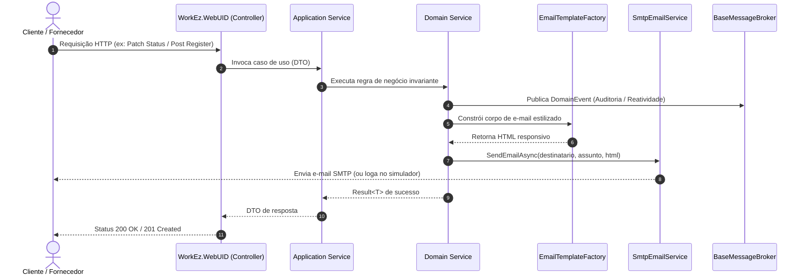

# 🏛️ WorkEz - Documento de Arquitetura de Software

## 1. Visão Geral
O **WorkEz** é um ecossistema para conexão e contratação de serviços profissionais sob demanda. O backend foi desenvolvido em **.NET 10** (C#) seguindo os princípios de **Domain-Driven Design (DDD)** e **Clean Architecture**, com separação estrita de responsabilidades, inversão de dependência e persistência via Entity Framework Core (PostgreSQL Neon Tech / In-Memory para testes).

---

## 2. Estrutura de Camadas e Módulos (`WorkEzApi`)

```
WorkEzApi/
├── WorkEz.Domain/            # Entidades, Enums, Value Objects, Eventos de Domínio, Interfaces e Factory de Templates
│   ├── Common/               # BaseEntity, Result Pattern
│   ├── Entities/             # User, Customer, ServiceProvider, Service, Proposal, Appointment
│   ├── Enums/                # ServiceStatus, ProposalStatus, AppointmentStatus, UserRole
│   ├── Events/               # DomainEvents (OrderStatusUpdated, ProviderAccepted, PaymentCompleted, UserRegistered)
│   ├── Interfaces/           # IEmailService, Repositories, Domain Services, IBaseMessageBroker
│   └── Services/             # EmailTemplateFactory, ProposalDomainService, ServiceDomainService, UserDomainService, PaymentDomainService
├── WorkEz.Application/       # Casos de uso, DTOs e orquestração de aplicação
│   ├── DTOs/                 # Request e Response DTOs
│   ├── Services/             # ProposalApplicationService, ServiceApplicationService, UserApplicationService, PaymentApplicationService
│   └── ValueObjects/         # PriceProposalVo (Cálculo de taxas de plataforma)
├── WorkEz.Infra.Data/        # Implementação de persistência e serviços de infraestrutura
│   ├── Context/              # AppDbContext (PostgreSQL / In-Memory)
│   ├── Repositories/         # BaseRepository, ProposalRepository, ServiceRepository, AppointmentRepository
│   ├── Services/             # SmtpEmailService (Envio real SMTP + Simulador Dev em logs)
│   └── MessageBroker/        # BaseMessageBroker (Despacho assíncrono de eventos)
├── WorkEz.Infra.Ioc/         # Composição de dependências
│   └── DependencyInjection.cs# Registro centralizado de serviços e repositórios
└── WorkEz.WebUID/            # API REST HTTP e documentação
    ├── Controllers/          # ProposalsController, ServicesController, UsersController, PaymentsController
    ├── Program.cs            # Pipeline ASP.NET Core, CORS, Swagger OpenAPI
    └── Tests/                # Testes de unidade e integração (xUnit)
```

---

## 3. Fluxo de Notificações por E-mail (Factory Pattern)

O sistema de envio de e-mails adota o **Factory Pattern** desacoplado da infraestrutura de rede:

1. **EmailTemplateFactory (`WorkEz.Domain.Services`)**:
   - Centraliza o layout responsivo base HTML (`BuildBaseLayout`) com gradiente e estilo visual consistente.
   - Gera o corpo e assunto dos e-mails temáticos:
     - `BuildOrderStatusUpdatedTemplate`: Notifica mudanças de estado com badges visuais de transição.
     - `BuildProviderAcceptedTemplate`: Notifica o cliente do aceite do prestador com valores e datas.
     - `BuildPaymentCompletedTemplate`: Notifica recibo e liberação financeira.
     - `BuildWelcomeUserTemplate`: Dá as boas-vindas e orientações iniciais ao novo usuário.
     - `BuildProposalNotificationTemplate`, `BuildProposalAcceptedTemplate`, `BuildProposalRejectedTemplate`.

2. **IEmailService & SmtpEmailService**:
   - Interface declarada no Domínio (`IEmailService`).
   - Implementação em `WorkEz.Infra.Data` utilizando `System.Net.Mail` com suporte a SSL/TLS e fallback inteligente: se as credenciais SMTP não forem preenchidas, ativa o **Dev Email Simulator** nos logs estruturados, garantindo que o ambiente nunca quebre por ausência de servidor SMTP externo.



---

## 4. Estratégia de Hospedagem (Vercel + Cloud Container)

A Vercel é especializada em Frontends (React / Expo Web / Next.js) e funções Serverless leves. Para garantir alta disponibilidade e latência mínima com o backend .NET 10:

- **Frontend na Vercel:** Deploy do `WorkEzApp` compilado via `npx expo export -p web`.
- **Roteamento Unificado (`vercel.json`):**
  - Configurado com `rewrites` redirecionando `/api/:match*` diretamente para a instância da API .NET no Render (`https://workez-api.onrender.com/api/:match*`).
  - O usuário acessa todo o ecossistema sob a mesma URL oficial (`https://workez.vercel.app`), com proteção CORS e certificados automáticos.
